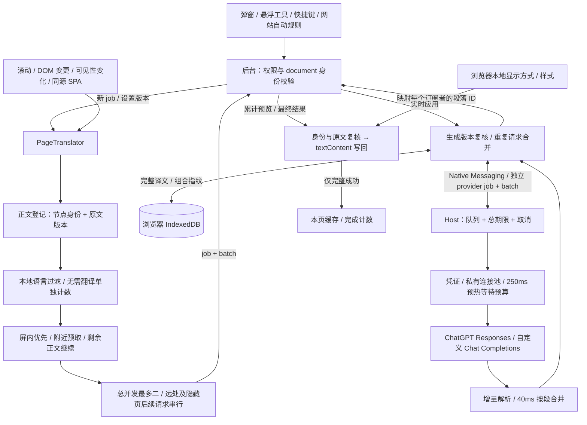

# 架构说明

Open Web Translator 由浏览器扩展和按需启动的本地辅助程序组成。扩展负责当前标签页和界面，本地辅助程序负责凭证、模型请求和并发队列。项目不需要自建远程服务器。

## 组件职责

`PageTranslator` 是当前页面翻译状态的唯一来源。正文提取优先采用完整的 `main`（含 `role=main`）区域；没有 `main` 时采用页面中所有外层 `article`，再退回 `body`。它保留文章内部 `header` 的标题，并可纳入正文根节点紧邻的单个明确 heading，同时排除站点导航、全局 header、表单、代码块、编辑区和隐藏内容。`SourceRange` 保存宿主、连续原文兄弟节点、文本和前后原始边界。嵌套块、列表、表格单元格、BR 与计算后的块布局结束当前范围，子块前后的散文分别登记；普通 div 仍采用受约束的正文回退。

译文用独立 span 和 textContent 写入范围末节点之后，仍留在对应 p、标题、li、td/th 内；默认作为块显示并继承宿主字体。父列表项译文位于子列表前，表格内容不会汇入外层容器，Flex/Grid 中原有段落项不会因新增兄弟译文而移格。原链接、inline code 和事件节点保持身份。身份和缓存以范围首原文节点登记；写回及动态协调同时检查宿主、节点顺序、文本和前后边界，边界变化即使文字相同也会取消旧范围。

扩展后台为每次开始或重试生成新的 `jobId`，并把 `{tabId, documentId, jobId, settingsRevision}` 及经后台核实的 URL、origin、强制重译和无痕标记保存到 `chrome.storage.session`。后台只接受当前扩展 UI 或匹配当前路由的顶层 content script 消息。

停止、恢复、导航或刷新会使该标签页尚在准备中的开始操作失效，并取消旧任务。路由的写入与清理按标签页串行，避免旧操作覆盖新任务；已失效的状态查询或注入不会阻塞用户再次开始。

设置页把模型目录按本地 profile ID 缓存在本次页面会话中，切换账号时分别显示。Host 端另有 60 秒内存缓存，使用 access token 的 SHA-256 摘要分区；原 token 不进入缓存键的可见形式，也不落盘。已知模型的思考档位来自集中维护的精确 slug 能力表；未知模型在 `auto` 下不发送推理档位。自定义 provider 的 `auto` 同样省略 `reasoning_effort`，手选才发送。

本地辅助程序通过 Native Messaging 读取长度前缀 JSON 消息。它限制并发请求、刷新 ChatGPT token、读取设置，并把请求交给当前 provider。浏览器断开 Native Messaging 后，本地进程停止；程序不会常驻监听业务端口。

ChatGPT 凭证读取走短路径：仍无需续期的 access token 可以直接使用，不会为每次模型请求重新获取 OIDC discovery。只有登录、需要刷新 token 或验证相关元数据时才进入对应的认证网络流程。

Host 为认证和模型请求创建自己的 Undici dispatcher，并通过 `globalThis.fetch` 的 dispatcher 参数使用它，不修改进程级全局 dispatcher。连接池最多建立 2 条同源连接，允许 HTTP/2；HTTP/1.1 空闲连接保留至多 60 秒，HTTP/2 会话的 PING 间隔为 60 秒。扩展后台在无待处理请求后保留 Native Messaging port 60 秒；port 关闭后 Host 退出并销毁 dispatcher。两段生命周期配合后，正常阅读和滚动停顿中的后续请求可以复用 TLS 连接，同时进程仍会在闲置后退出。

弹窗读到有效配置后发送一次无参数 `connection.prepare`，Host 从保存的配置选择 origin。冷态预热用同一 dispatcher 并发发送两次 `OPTIONS origin/`，不带认证头或正文，不跟随重定向，也不读取或刷新 ChatGPT access token。同源准备请求合并成一个任务；已有连接或正常请求正在建连时，跳过额外探测。准备中的真实请求等待同一任务，单个请求取消不取消其他等待者。两项探测共享一个 8 秒期限和取消信号，各自响应上限 64 KiB；真实请求至多等待 250 ms，随后取消慢探测、完成清理并发送一次模型请求。失败不阻止后续正常模型调用。`ready` 仅表示传输连接仍存在，不表示账号、模型或额度已通过验证。

## 一次翻译的连续流程

1. 用户点击“翻译正文”。扩展后台并行读取当前 provider 配置、使用 `activeTab + scripting` 向顶层页面注入 content script。两项都完成且配置有效后才发翻译命令，注入本身不提取或发送正文。
2. 后台创建 `jobId`，固定本次任务的 `documentId` 和 `settingsRevision`。
3. 页面脚本提取当前正文，使用节点身份和原文版本登记文本范围。MutationObserver 监听 documentElement，合并变更后重新发现正文；只新增或更新变化项，不重复提交已完成范围。长段先切成不超过 1500 字符的块。当前屏幕内最多 3 个短段合批流式请求；长段单独按块调度，并优先照顾未派发段落；屏外预取以最多 2 个文本块、合计不超过 1800 字符的 JSON 批次发送。页面和 Host 都维持最多 2 个模型请求并发，Host 仍独立执行每批 5 块、4000 字符的协议安全上限。
4. 后台确认消息仍属于当前标签页任务，并重新核实生成配置版本。`TranslationReuse` 先读取有效持久缓存；未命中的相同文本加入共享在途请求，仅把仍缺失的文本合批交给本地辅助程序。共享任务使用独立 provider job/batch，累计预览与最终结果映射回各页面自己的段落 ID。
5. 本地辅助程序再次检查配置版本，通过 Host 私有连接池向 ChatGPT Responses API 或 `${customBaseUrl}/chat/completions` 请求模型。
6. 单段流式请求使用累计纯文本，多段流式输出通过有长度限制的 JSON 状态机提取累计文本。Host 每 40 ms 按段落 ID 合并进度并尾随发送，及时检查任务和批次存活状态。最终结果仍要求每个段落 ID 恰好一次。多段结果缺失、重复、包含未知 ID、空译文或响应未完成时，整个批次失败。
7. 页面脚本在每次预览和最终结果到达时检查 `jobId`、`batchId`、页面代次、URL、原节点和完整原文。增量预览可以更新屏内译文节点，但只有 provider 完整结束后才增加完成计数并写入页面缓存。取消、旧任务或变化页面的迟到进度与最终结果都会被丢弃。

调度器按当前视口、最近滚动方向的附近范围、其余有布局正文三个等级选取下一批。屏内和附近保持最多两个请求；只有其他请求已经结束时才派发一个远处批次，完成后继续下一批，不要求用户滚动。隐藏标签页允许已有请求自然结束，后续同样每次只派发一批。两名 worker 每次派发前重新计算位置；暂时没有合适工作但仍有请求在途的 worker 等待唤醒，动态发现、滚动、可见性变化和请求结束都能让空闲位置立即补位。最后一个 worker 退出时再次检查可调度工作，避免收尾期间漏掉新增正文。

仅在可见页面存在尚未分配请求的屏内文字时，才通过 `jobId + batchId` 精确取消远离保留范围的批次。译文插入引起的滚动锚定不会无意义地取消后台补全；仍可见的流式请求继续保留。返回页面重新排序，但可见性事件本身不创建滚动阅读计时。剩余正文处理期间状态仍为 `running`；`watching` 仅用于等待正文出现或范围恢复布局。整页完成后继续监听动态正文。停止、恢复和取消后的迟到响应沿用原来的代次保护。

这一策略会继续处理已加载的正文，并可能增加一次阅读的模型用量；不主动滚动、点击“加载更多”或获取下一页。后台工作依赖页面尚未被浏览器冻结或丢弃，关闭页面和系统睡眠不在持续执行保证内；没有为此新增权限或改变 Host 空闲生命周期。

## 状态与一致性

页面状态包括 `idle`、`running`、`watching`、`paused`、`completed`、`stopped` 和 `error`。停止、恢复、重新开始或 URL 变化都会推进页面代次，使旧请求无法回填。动态改文取消关联批次，未变化的同批段落重新排队；节点删除、替换和旧文本结果不能进入新版本缓存。失败批次重新提取正文，只请求缓存缺失或已失效的段落。

Host 同时保留任务级和批次级取消控制器。页面停止、恢复、远屏取消或原文失效先在后台解绑对应订阅者；共享模型批次无人需要后才向 Host 取消，其他仍有订阅者的工作继续。生成配置或账号变化则取消旧生成版本下的任务。取消可以早于 translate 消息到达，Host 用有容量上限的短期墓碑拒绝这种迟到批次。进度回调和最终结果在发出前都会再次检查取消信号与配置世代。

ChatGPT 在 `response.completed` 后结束请求，自定义流式 API 在 `finish_reason: "stop"` 后结束请求，两者均主动关闭流读取器，不等待服务器关闭 HTTP 连接。截断、拒绝或提前断流不会提交完成结果。

`settingsRevision` 由本地设置版本、当前 ChatGPT profile、登录状态和计划授权状态共同生成。生成配置、账号或授权状态变化后，正在执行的旧版本任务不能继续提交结果。普通 access token 刷新不会改变翻译配置版本。

页面内缓存同时匹配原文范围的节点身份、宿主和边界，以及 URL、完整原文和 `settingsRevision` 才能复用。恢复原文只移除译文并还原暂存原文，随后普通开始仍可复用有效缓存。强制重译清空本页内存缓存，并绕过持久缓存、旧共享任务及语言过滤；新的完整结果可以更新持久缓存。

## 跨刷新缓存与请求合并

`TranslationCache` 默认使用扩展 origin 下的 IndexedDB。键是 origin、完整 URL（含查询及片段）、`settingsRevision`、`TRANSLATION_PROMPT_VERSION` 与完整原文块共同计算的 SHA-256。相同文字在不同页面地址或生成版本中分别处理；刷新、换节点或在另一个标签打开同一地址仍可命中。数据库只持久化键、origin、完整译文、创建/访问时间和估算大小，不写明文原文、完整 URL 或凭证。译文可能包含私密内容，origin 也会暴露访问过的网站；哈希不等同于译文加密。

默认写入后 30 天过期，最多 2000 条、约 5 MiB 记录预算，超限按最近最少使用淘汰。设置页提供持久缓存开关、全量清除和按 origin 清除；关闭不删除旧记录，清除不移除 DOM 译文。缓存故障降级为正常模型请求，统计显示不可用而非空缓存，清除失败明确报告。清除/停用推进缓存代次，阻止原有在途结果重新写回。无痕及停用缓存时不读写持久记录，也不跨页面共享请求；同一 job 内仍可合并重复文字。

`TranslationReuse` 为重复原文维护订阅者和独立的模型批次。一个页面停止、取消或改文只解绑自身；只要另一个页面仍需要同批内容，模型请求继续，最后一个订阅者离开才取消底层批次。失败、空译文、缺失/重复 ID 或不完整终态不会缓存。强制任务与旧任务隔离，同一强制 job 内仍能合并，较早任务的迟到结果不能覆盖较新的生成。页面端仍独立检查原文范围与代次，缓存命中不能绕过 DOM 身份校验。

## 生成配置与显示偏好

目标语言、provider、模型、API 地址/Key 和思考强度属于生成配置。Host 比较规范化后的值，只有这些值实际变化才更新设置版本并取消旧生成；保存相同配置、仅修改 legacy 显示字段或保存失败不会终止流式请求。保存串行化，并与 status、派发前校验和最终结果提交协调，避免新版本可见但旧任务尚未失效。账号/授权状态继续参与 `settingsRevision`，普通 token 刷新不参与。

双语/仅译文独立保存为 `chrome.storage.local.translationDisplayMode`。旧 Host `displayMode` 仅用于本地值不存在时的兼容迁移，不能覆盖较新的本地选择；设置页和 content 通过存储变更实时应用。Host 离线时仍可修改显示，不改变 prompt、生成版本或翻译缓存。

## 保守语言过滤

页面在创建原文范围时调用本地 `isAlreadyTargetLanguage`，有足够证据才标为 `skipped`，不创建译文节点或模型请求。`completed` 只表示真实译文完成，跳过单独计数；阅读范围结算包含这些已可阅读原文，但不会制造“译文首字”事件。动态原文新增、变更或继承的 `lang` 改变后重新判断，强制重译绕过判断。

空白、数字和符号直接保留。中文要求足够汉字及多个语法信号，并通过有限的中性/简繁字符集合检查；含日文假名、韩文或拉丁文字、未知汉字和有歧义的简繁形式继续翻译。日文要求足够假名、各句都有假名；韩文要求足够纯 Hangul。英/法/德/西语同时要求匹配的 `lang`、正文长度、功能词与竞争语言检查。短标题、名字、技术混排或缺少语言线索可能多翻，这不是通用语言检测器，也不依赖外部识别服务。

## 凭证与文件

本地辅助程序把设置和 ChatGPT profile 保存在默认数据目录。写入过程先创建同目录临时文件，执行 `fsync`，再通过 rename 原子替换目标文件。目录权限为 `0700`，JSON 文件权限为 `0600`。旋转 refresh token 的读取、刷新和保存由文件锁串行化，避免两个浏览器进程重复使用同一旧 token。认证与设置分别使用 `.chatgpt-auth.lock` 和 `.settings.lock`，锁的所有权目标也保持独立；这项隔离修复的是并发保存正确性，不是此前约 9 秒首字延迟的原因。

这些文件依赖操作系统权限隔离，没有使用 macOS Keychain、Linux Secret Service 或其他系统钥匙串。

## 网络与信任边界

- 网页只能向扩展发送页面任务消息，不能指定 provider URL、请求头或凭证。
- 扩展只把当前设置选中的正文发送给本地辅助程序。
- 本地辅助程序只请求已保存的自定义 API 地址或固定的 OpenAI API 地址。
- 打开弹窗在连接池冷态时会向当前服务 origin 并发发两次不带凭证或正文的 OPTIONS 连接探测；不会自动发送模型请求，普通状态轮询也不会重复探测。
- 模型输出经过结构校验后以 `textContent` 写入网页，不执行远程 HTML 或脚本。
- ChatGPT 登录会临时启动 `127.0.0.1` HTTP 回调；其余模型通信不开放本地 HTTP 服务。
- Native Messaging manifest 只允许仓库固定公钥产生的扩展 ID。

## 自动运行与权限

手动开始使用 `activeTab + scripting`。按站自动翻译使用 `optional_host_permissions`：弹窗用户动作申请精确网站权限，成功后保存 origin 规则并注册持久 content script；新 document 在 `page.ready` 时重新检查规则、权限和 document 身份才开始。权限撤销或关闭规则会停止相关任务并清理注册。

同 document SPA 使用 URL 变化事件和 250 ms URL 轮询，避免隔离世界的 history 补丁无法观察网页主世界调用。后台把续译意图与 documentId、origin、导航序号绑定；加载事件可以取消旧 job，但不能误删同 document 续译意图。新 document 必须重新通过站点规则检查。停止和恢复清除续译授权，迟到 ready/navigate 不可重新启动。快捷键复用同一任务入口。

仅译文模式保持宿主和译文可见：完整成功且安全的范围暂存直接 Text 的内容并清空其 data，对直接原元素设置专有隐藏属性，不替换或移动原节点。提取时同步恢复原文可见性，再按有效范围恢复隐藏。自身字符变化从观察器记录中精确剔除，宿主变更仍参与动态校验；宿主主动写入原 Text（包括空串）后即放弃旧备份，恢复时不覆盖新内容。含链接、交互、列表和部分容器范围保留双语。恢复、变更和取消会清除对应隐藏状态。

译文装饰和字号单独存于 `chrome.storage.local.translationAppearance`，不进入 Host 设置、请求 prompt 或缓存键。设置页与 content 共用 `translation-style.ts` 中的枚举校验和样式生成函数；content 通过 storage 变更更新唯一的译文 stylesheet，已有和随后插入的译文都适用。原文节点不改样式，样式节点的更新也不会触发正文重扫。初始读取与变更通知有版本保护，BFCache 恢复时重新读取偏好。

可选 `textColor` / `backgroundColor` 字段仅接受六位十六进制颜色；省略时使用原有样式和主题默认值，旧数据无需迁移。自定义颜色覆盖所有装饰样式，并在深色主题下保留用户选择。选色器的 input 事件即时更新预览，存储写入采用一个执行中任务与最新待写值合并，避免拖动选色时积累过期写入；分别恢复颜色不改变字号或装饰。

## 当前边界

未覆盖 iframe、Shadow DOM、PDF 和字幕。动态发现当前采用合并后的正文扫描，尚未针对超大 DOM 做局部扫描索引；按站自动翻译需要浏览器授予可选权限。持久缓存以完整页面地址和生成版本隔离，不跨不同文章地址共享；语言过滤可能保留多余请求。服务端用量缺失或取消后的真实成本未知；真实模型整页质量和更多站点仍需单独验收。

## 等待期限与性能记录

Host 翻译默认总期限 180 秒，覆盖共享队列等待与模型执行；排队过期不派发模型，执行中过期传播取消。Native 客户端 240 秒超时是后备防线，会在原 port 发送无新 timer 的 batch/job 取消。取消槽位在实际操作结束后释放。

各层 TimingLog 最多保留 500 条不含正文的事件，通过 jobId/batchId 关联；后台 `reuse.link` 另关联独立 provider job/batch，`reuse.end` 标明订阅请求是否成功及关联的模型组数。统计按唯一模型组去重，缓存命中不能被当作模型派发。单调时钟仅在同层相减；点击到首个可见译文另用同机 wallclock 差值记录 `ui.firstVisible`。页面记录提取、动态发现、DOM 首字、视口完成；Host 记录排队、认证、请求、首增量、terminal 与实际提供的 token 数。可在弹窗导出 JSON。请求派发到增量仍混合连接、网络、服务端排队和模型时间，不能解释成纯推理时间。

## 阅读范围与同屏优先级

调度的几何位置按连续原文节点创建 DOM Range 测量，不再用宿主 LI 的整个子树矩形。双语模式同时纳入该范围已显示译文的矩形，避免取消仍在阅读的长流式预览；仅译文模式使用已显示译文的位置。视口排名、滚动方向和远屏批次取消共用这一边界，因此长嵌套列表中的远处引言不会占用当前屏幕的请求位置。

main 内只有一篇可见外层 article、文章至少 400 字符且正文字符数至少为外围的 4 倍时，文章和紧邻的明确标题获得同屏优先级。顺序为“当前视口/预取等级 → 文章优先级 → 原有公平调度”。外围摘要和文件元信息仍保留，不改变全部原文范围或总用量的上限，也不保证减少请求数。

## 悬浮控制与界面状态

悬浮工具仅提供“翻译 / 显示原文”切换，复用既有书页图标，不包含面板或其他操作。它作为带 `data-open-web-translator-ui` 标记的 Shadow DOM 宿主挂在 documentElement。正文提取和动态发现忽略该标记，恢复原文不删除控件，替换 body 也保留入口。PageTranslator 仅在公开状态改变时通知控件，不新增进度轮询或翻译调度器。扩展上下文失效时统一移除控件和监听。

`page.control` 只能来自本扩展的顶层 HTTP/HTTPS 内容脚本，目标固定为发送者 tab/document。开始动作继续经过脚本注入与配置校验，并核对实际注入 document；停止/恢复消息绑定 document，取消在串行路由更新内复核 document 和 epoch。`page.openSettings` 只能打开扩展设置，不开放 host.request、凭证或任意网址。已有权限模型不变。

显示方式与悬浮开关/位置仍在浏览器本地保存，不属于生成配置或缓存键。悬浮工具的进度以 PageTranslator 的实时通知为准，后台迟到的成功确认不会覆盖较新的进度；初始偏好读取和后续存储事件分别按字段处理版本，避免位置更新吞掉开关读取。
